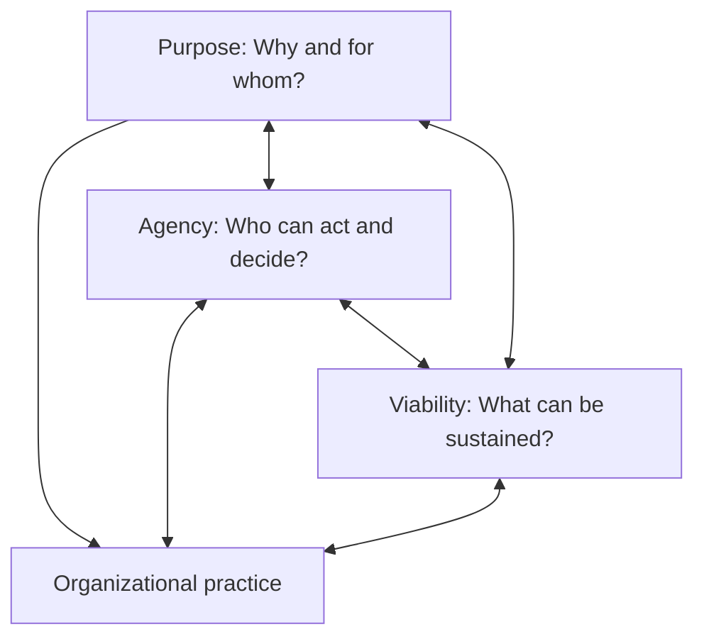
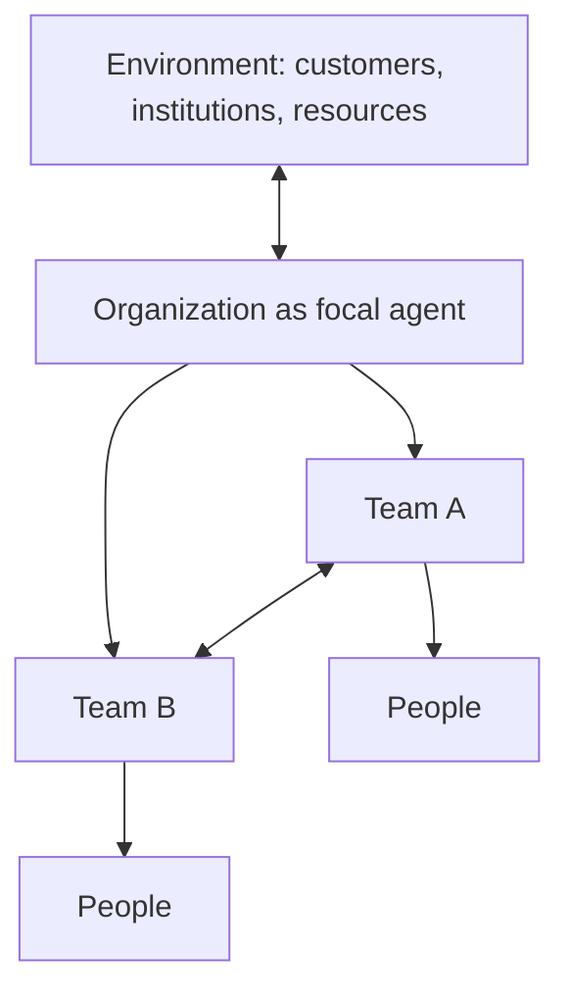
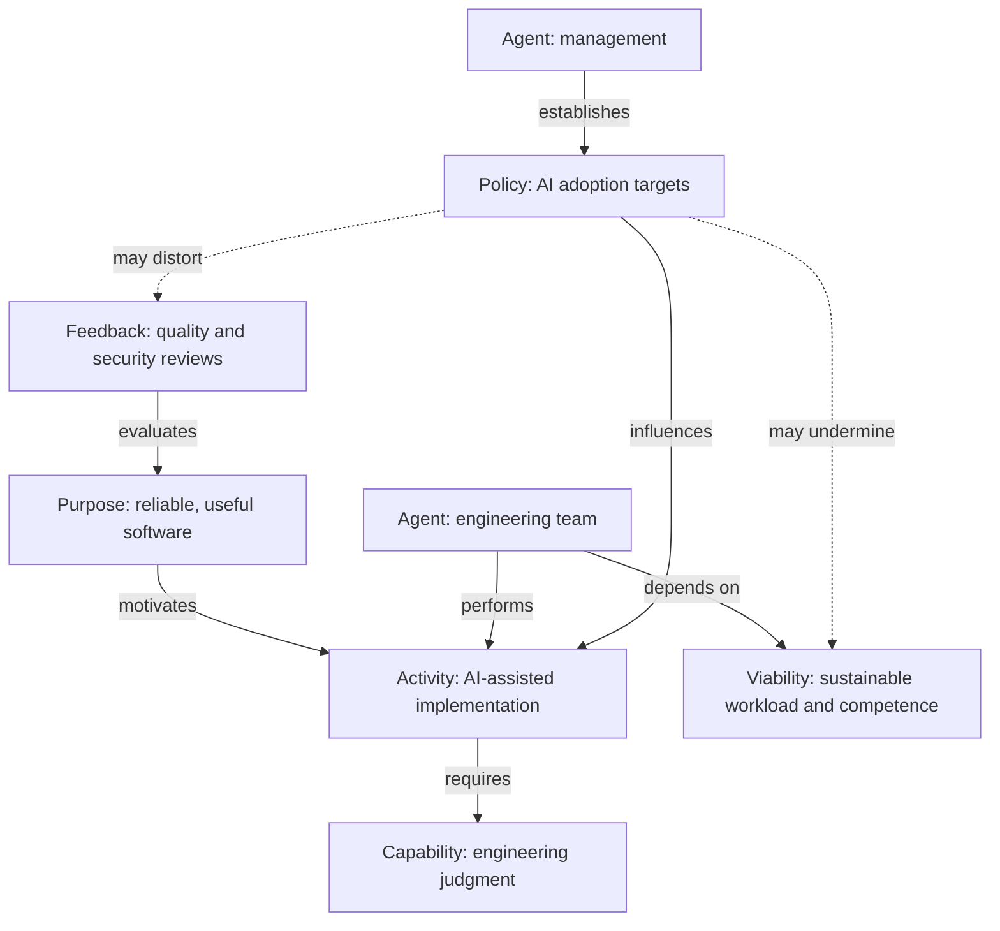

# Purpose–Agency–Viability (PAV) Model

**Human Viable Systems Modeling (HVSM) — draft specification v0.1**  
**Status:** Proposed conceptual diagnostic model, not an empirically validated assessment instrument.

## Overview

Purpose–Agency–Viability (PAV) is proposed as HVSM's foundational diagnostic model. It complements enterprise modeling approaches such as 4EM by examining not only whether activities align with stated goals, but whether the means used to pursue those goals sustain the autonomy, capabilities, and long-term viability of participating and affected agents.

> How do a system's purposes, distribution of agency, and operating practices affect the viability of itself, its constituent agents, and the other systems it depends on?

PAV is intended for participatory organizational analysis and redesign, not to assign a universal score to organizational health.

## Three connected views

| View | Models | Typical misalignments |
| --- | --- | --- |
| **Purpose** | Goals, beneficiaries, values, success criteria | Means–ends inversion; conflicting or displaced goals |
| **Agency** | Agents, decision rights, responsibilities, dependencies, participation | Power concentration; responsibility without authority |
| **Viability** | Capabilities, resources, regeneration, depletion, risks | Unsustainable practices; capability erosion; externalized costs |

The views are interdependent. A goal may be attainable but illegitimate; a decision may be participatory but ineffective; a process may be productive in the short term but consume the capacities on which it depends.

## Minimal modeling vocabulary

| Construct | Definition |
| --- | --- |
| **Agent** | An individual or collective capable of decisions and actions at the chosen analytical scale |
| **Purpose** | A desired outcome together with the reason and beneficiaries for pursuing it |
| **Activity** | Work undertaken to pursue a purpose |
| **Capability** | An ability required to act effectively |
| **Authority** | Legitimate power to make, influence, or contest a decision |
| **Dependency** | Something an agent requires from another agent or its environment |
| **Viability condition** | A condition necessary for continued functioning and adaptation |
| **Feedback** | Information enabling evaluation, correction, and learning |

Initial relationship vocabulary: `pursues`, `performs`, `requires`, `dependsOn`, `authorizes`, `affects`, `monitors`, and `constitutes`.

Relationships should be evidenced and interpretable. For example, an agent that `performs` an activity but lacks authority over decisions needed to perform it safely may exhibit an authority–responsibility mismatch.

## Recursive agents and boundaries

The basic unit is an **agent situated in an environment**, not a box in an organization chart. An agent can be a person, team, organization, institution, or interorganizational network depending on analytical scale. An organization may be modeled as an agent constituted by agents; however, operational agency of collectives must not be confused with the moral standing of persons.

**Non-inference rule:** the viability of a parent does not imply the viability of its constituent agents. An organization can remain profitable while exhausting its workers. Conversely, local autonomy does not guarantee effective coordination or the viability of the whole.

## Diagnostic patterns

These are proposed patterns for investigation, **not** validated classifications or automatic judgments.

| ID | Pattern | Signal | Example |
| --- | --- | --- | --- |
| D1 | **Means–ends inversion** | A proxy or tool displaces the purpose it serves | Measuring AI adoption rather than reliable software |
| D2 | **Authority–responsibility mismatch** | Accountability without power to influence outcomes | Engineers responsible for security but unable to delay release |
| D3 | **Viability externalization** | One agent improves its position by shifting costs onto another | Chronic overtime used to meet delivery targets |
| D4 | **Regenerative deficit** | Capabilities are depleted faster than restored | Training and maintenance consistently displaced |
| D5 | **Feedback suppression** | Information about problems cannot reach or influence decision-makers | Criticism penalized, defects left unreported |
| D6 | **Agency capture** | Structural dependency without meaningful participation or recourse | Teams lose workflow authority while retaining obligations |

## Worked example: AI-assisted development

**Fictional case.** A software organization adopts mandatory AI code-generation targets to improve delivery throughput. The affected team is concerned about verification time, authority to block releases, and retention of engineering competence.

The dashed edges are **hypotheses**, not findings. An assessment must investigate whether mandatory adoption changes engineering judgment, verification quality, learning, and feedback. Distinguish direct observation, stakeholder reports, interpretation, and untested causal hypotheses.

## Participatory diagnostic workflow

1. **Scope:** Identify the focal agent, constituent agents, affected stakeholders, boundaries, and stated purposes.
2. **Model:** Map activities, capabilities, authority, dependencies, viability conditions, and feedback.
3. **Diagnose:** Identify tensions across purpose, agency, and viability, separating evidence from interpretation.
4. **Deliberate:** Invite affected agents to evaluate trade-offs, contest findings, and propose alternatives.
5. **Redesign:** Change decision rights, workflows, policies, resource allocations, or feedback mechanisms.
6. **Evaluate:** Assess whether outcomes improve without shifting unacceptable costs to others.

### Example alignment register

| Finding | Affected agent | Intervention | Evidence of improvement |
| --- | --- | --- | --- |
| Security responsibility without release authority | Engineering team | Explicit review and stop-release rights | Review outcomes, incident trends, team feedback |
| AI-adoption metric displacing quality | Engineering and customers | Evaluate verified delivery outcomes | Defects, reliability, customer outcomes |
| Learning time squeezed out | Engineers | Protected learning and maintenance capacity | Skills development, sustainable workload |

## Governance safeguards

HVSM itself could be misused as a management instrument for extracting more output from workers. A company might measure resilience and then demand that employees tolerate worse conditions instead of improving those conditions.

Four methodological commitments mitigate this risk:

- **Participation:** Affected agents meaningfully contribute to and contest the model.
- **Transparency:** Assumptions, evidence, uncertainties, and value judgments are visible.
- **Contestability:** Findings and interventions can be challenged through defined processes.
- **Reciprocity:** Benefits and burdens across agents are explicitly considered.

These commitments do not eliminate conflict. They make it legible and subject to accountable deliberation.

## Minimum viable pilot

**Scope:** one engineering team, one organizational policy, one delivery process.

**Deliverables:**

1. Purpose model identifying beneficiaries and desired outcomes.
2. Agency map identifying decision rights and responsibilities.
3. Viability map identifying critical capabilities and dependencies.
4. Register of evidence-backed organizational tensions.
5. Participatory intervention proposal with evaluation criteria.

A pilot succeeds as a *methodological* test if it reveals meaningful, actionable relationships that ordinary goal/process modeling misses or struggles to express. It need not prove universal productivity gains.

## Working definition

> **Human Viable Systems Modeling (HVSM)** is a participatory, recursive organizational modeling framework for analyzing and improving the alignment of collective purposes, distributed agency, and the long-term viability of constituent and affected systems.
>
> Its foundational **Purpose–Agency–Viability model** examines how organizational goals, activities, decision structures, and dependencies contribute to or undermine the capabilities, autonomy, and sustainability of participating agents.

## Open design questions

- Distinguish persons, collective agents, and environments more formally.
- Define relationship semantics and a compact graphical notation.
- Specify how contradictory stakeholder claims and competing purposes are represented.
- Clarify what evidence justifies an identified viability risk.
- Determine how PAV interoperates with 4EM, ArchiMate, VSM, and sociotechnical design methods.
- Treat **autopoiesis** as a theoretical influence, not a literal biological property of organizations.

The immediate design objective is a practical model that makes visible when organizations achieve goals by strengthening their constituent agents—and when they do so by depleting or subordinating them.