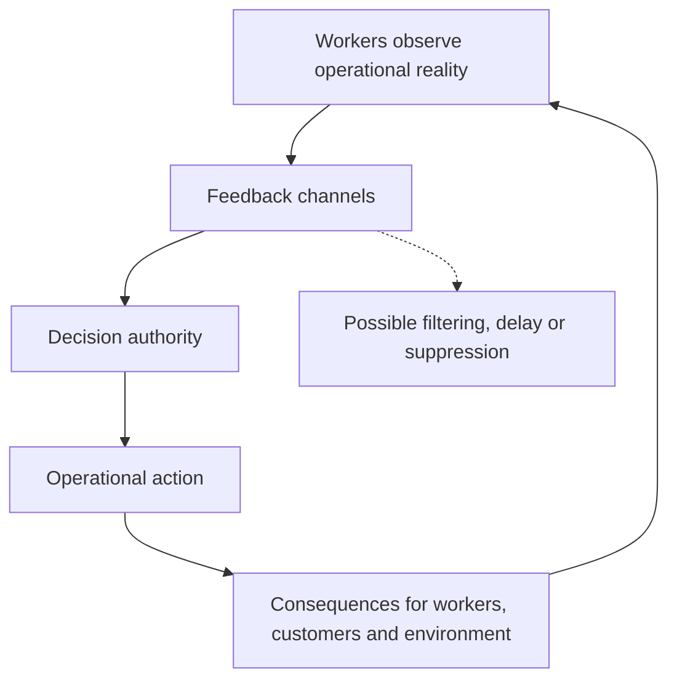

# 08 — Governance alienation and participatory viability

**Human Viable Systems Modeling (HVSM) — extension to Purpose–Agency–Viability (PAV)**  
**Status:** Proposed diagnostic principle; not an empirically validated classification.

## Central claim

Organizational dysfunction can arise when those who **perform and sustain work**, those who **exercise authority**, those who **receive value**, and those who **bear consequences** are different groups. This is not a division between “stakeholders” and “agents”: workers, customers, investors, creditors, and communities are all stakeholders. The relevant distinction is between **affected stakeholders** and **governing stakeholders**.

Workers can be held responsible for outcomes while lacking authority over the conditions under which they work (**responsibility–authority asymmetry**). Economic rewards may likewise accrue to groups that do not bear corresponding risks or costs (**distributional asymmetry**).

## Four distributions to model

| Dimension | Question |
| --- | --- |
| **Work** | Who contributes labor, knowledge, care, and operational capabilities? |
| **Authority** | Who sets purposes, rules, budgets, and decisions? Who can contest them? |
| **Value** | Who receives economic and non-economic benefits? |
| **Consequences** | Who bears costs, risks, dependency, losses, and environmental impacts? |

Divergence between these distributions is a reason for investigation, not automatic proof of exploitation. Record evidence, justification, affected interests, and institutional safeguards.

## Marxian alienation

In Marx's *Economic and Philosophic Manuscripts of 1844*, alienated labor is discussed in relation to the **product**, the **activity of labor**, **human potential (species-being)**, and **other people**. These dimensions offer a critical lens on workers lacking control over their work, its products, collective purposes, and relationships.

**Experienced autonomy is not structural autonomy.** A person may enjoy their work and be well compensated while lacking any protected influence over the organization's direction. Benevolent leadership is not a substitute for durable governance rights.

## Cybernetic interpretation

Operational knowledge is often located among those performing work. Centralized decisions require information to travel upward and instructions downward. Reporting may filter, delay, or suppress crucial signals, reducing adaptive capacity.

Decentralization is not universally superior. The practical question is which decisions require local authority, coordination, representative governance, or centralized accountability.

## Institutional remedies

- **Worker cooperatives:** democratic member ownership and governance.
- **Codetermination:** protected worker representation in governance.
- **Employee ownership:** financial participation, not necessarily voting authority.
- **Self-managing teams:** distributed operational decision-making.
- **Multistakeholder cooperatives:** participation by workers, users, and other groups.
- **Participatory budgeting and contestation rights:** influence over resources and the ability to challenge decisions.

These are distinct mechanisms. Worker ownership does not automatically prevent exploitation of nonmembers, customers, or the environment; autonomy without coordination may also undermine collective viability.

## D7 — Governance alienation

**Definition:** A structural condition in which agents substantially responsible for producing or sustaining organizational value lack meaningful authority over the purposes, rules, or distributional decisions governing their contributions.

**Indicators to investigate:**

1. Responsibility without corresponding decision rights.
2. Limited representation in strategic or resource-allocation decisions.
3. Inability to challenge decisions without retaliation.
4. Financial benefits disconnected from burdens borne by contributing agents.
5. Operational knowledge systematically excluded from governance.

**Possible interventions:** accountable delegation, protected representation, cooperative ownership, participatory budgeting, contestation rights, and self-governing teams.

D7 is a diagnostic prompt, not an automatic ethical verdict.

## Participatory viability

> A viable organization should maintain the capacities of its constituent agents to participate meaningfully in determining the purposes, conditions, and consequences of their collective activity.

This principle goes beyond employee satisfaction and financial ownership. Customers and communities can have legitimate governance claims without becoming employees or shareholders. The goal is **not to eliminate authority but to make it accountable to the agents whose work and viability it governs**.

## Recursive application

| Focal system | Agents | Governance question |
| --- | --- | --- |
| Team | Workers | Can members influence work and shared decisions? |
| Company | Workers, teams, owners, customers | How are authority, benefits, and burdens distributed? |
| Cooperative network | Member organizations | Who governs shared infrastructure? |
| National economy | People, firms, institutions | Who shapes economic decisions, and whose interests count? |
| International system | States, institutions, communities | Who governs shared resources and bears externalized costs? |

These are analytical scales, not claims that companies and states possess the moral standing of persons. Larger scales require political concepts such as rights, citizenship, sovereignty, and legitimacy.

## PAV integration

- **Purpose:** Who defines goals, and who benefits?
- **Agency:** Who acts, decides, participates, and can contest decisions?
- **Viability:** Whose capacities improve or deteriorate, and who absorbs costs?
- **Governance trace:** Compare the four distributions and record evidence, disagreements, and proposed interventions.

## Open design questions

- What degree of affectedness justifies representation or veto rights?
- How should conflicting interests of workers, customers, communities, and investors be reconciled?
- How should authority be allocated across recursive levels?
- How can participation rights outlast particular managers?
- What evidence would demonstrate improved long-run viability?

**Related traditions:** Marxian alienation; industrial democracy; cooperatives; codetermination; sociotechnical systems design; Stafford Beer's Viable System Model; Elinor Ostrom's polycentric governance; organizational justice; stakeholder theory.
